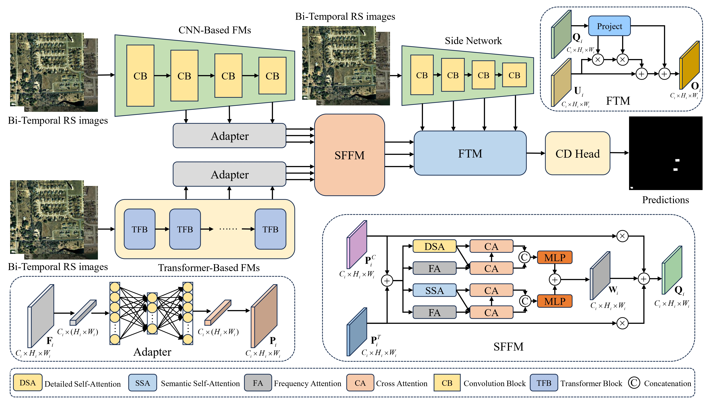

# ACTNet: Adapting CNN-Transformer-Based Foundation Model for Remote Sensing Change Detection
This repository provides the official implementation of our [paper](https://www.sciencedirect.com/science/article/pii/S0031320326010319) published in Pattern Recognition., by Jiaen Chen, Da Wu, Quanqing Ma, Zhe Zhao, Yuanfeng Wu, Yuanyuan Ren, and Yuchen Zheng.

## Introduction

Remote Sensing Change Detection (RSCD) aims to identify changes in the same geographic area by comparing remote sensing images captured at different time periods. It plays an important role in applications such as urban expansion monitoring, disaster assessment, land-cover analysis, and environmental observation.

A major challenge in RSCD is the limited availability of labeled data, which often restricts the performance and generalization ability of deep learning models. Although recent studies have attempted to leverage knowledge from pre-trained foundation models, these models may still suffer from representational limitations caused by domain gaps between natural images and remote sensing imagery, as well as architecture-specific inductive biases.

To address these challenges, this work proposes **ACTNet**, a novel framework that adapts both CNN-based and Transformer-based foundation models for remote sensing change detection. ACTNet introduces a stage-wise adapter to efficiently align feature distributions from foundation models trained with different data streams and training strategies. It also incorporates a **Spatial-Frequency Fusion Module (SFFM)** to jointly exploit spatial-domain and frequency-domain representations, enabling the model to capture both fine-grained details and high-level semantic information.

Furthermore, ACTNet uses cross-attention to connect foundation models with a lightweight side network, allowing task-specific features to be learned with limited memory and computational overhead. This design effectively transfers universal knowledge from foundation models to the RSCD domain and can be integrated into many existing change detection methods.

Extensive experiments on four benchmark datasets demonstrate that ACTNet achieves state-of-the-art performance in remote sensing change detection.
<p align="center">
  
</img>

<p align="center">
  <em>Overview of the proposed ACTNet framework.</em>
</p>

## Installation

This project is built upon the Open-CD framework and uses components related to Focal Attention. Please refer to the official installation instructions of the following repositories before running this project:

- [Open-CD](https://github.com/likyoo/open-cd)
- [Focal Transformer](https://github.com/microsoft/Focal-Transformer)
- [Agent Attention](https://github.com/leaplabthu/agent-attention)

We recommend first setting up the environment following the Open-CD installation guide, and then installing the dependencies required by Focal Attention according to the official Focal Transformer repository.

A typical installation workflow is as follows:

```bash
# 1. Create and activate a virtual environment
conda create -n actnet python=3.10 -y
conda activate actnet

# 2. Install dependencies following Open-CD
# Please refer to:
# https://github.com/likyoo/open-cd

# 3. Install dependencies following Focal Transformer / Focal Attention
# Please refer to:
# https://github.com/microsoft/Focal-Transformer
```

## Results

### Quantitative Results on LEVIR-CD

| Method | Year | Backbone | F1 (%) | Pre. (%) | Rec. (%) | IoU (%) | OA (%) |
|---|---:|---|---:|---:|---:|---:|---:|
| BIT | 2021 | ResNet18_S5 | 89.31 | 89.24 | 89.37 | 80.68 | 98.92 |
| ChangeFormer | 2022 | MIT-B1 | 91.11 | 92.59 | 89.68 | 83.67 | 99.04 |
| Changer | 2023 | ResNeST-101 | <ins>92.33</ins> | 93.38 | 91.31 | <ins>85.76</ins> | - |
| BAN + ViT-L | 2024 | MiT-B2 | 92.30 | <ins>93.61</ins> | 91.02 | 85.69 | - |
| ChangeMamba | 2024 | Mamba-B | - | - | - | - | - |
| CDMamba | 2024 | - | 90.75 | 91.43 | 90.08 | 83.07 | 99.06 |
| CDMaskFormer | 2024 | MiT-B2 | 92.26 | 93.35 | 91.19 | 85.63 | <ins>99.22</ins> |
| BiFA | 2024 | MiT-B0 | 90.69 | 91.52 | 89.86 | 82.96 | 99.06 |
| ChangeViT-S | 2025 | ViT-S | 91.98 | - | - | 85.16 | 99.19 |
| AdaptVFMs-RSCD | 2025 | - | 90.85 | - | - | - | 99.09 |
| DynamicVis-L$^{2X}$ | 2025 | - | 92.32 | **93.97** | 90.48 | 85.31 | - |
| BAN + InternImage-XL | 2024 | MiT-B2 | 92.28 | 93.24 | 91.34 | 85.66 | <ins>99.22</ins> |
| BAN + EVA02-L | 2024 | MiT-B2 | 92.28 | 93.32 | 91.26 | 85.67 | <ins>99.22</ins> |
| ACTNet (MLP Head) | 2026 | MiT-B2 | **92.47** | 93.36 | <ins>91.60</ins> | **86.00** | **99.24** |
| ACTNet (Mask Head) | 2026 | MiT-B2 | 92.24 | 92.79 | **91.70** | 85.60 | 99.21 |

### Quantitative Results on WHU-CD

| Method | Year | Backbone | F1 (%) | Pre. (%) | Rec. (%) | IoU (%) | OA (%) |
|---|---:|---|---:|---:|---:|---:|---:|
| BIT | 2021 | ResNet18_S5 | 83.98 | 86.64 | 81.48 | 72.39 | 98.75 |
| ChangeFormer | 2022 | MIT-B1 | 94.31 | 95.50 | 93.16 | 89.24 | 93.16 |
| ChangeMamba | 2024 | Mamba-B | 94.19 | 96.18 | 92.23 | 89.02 | 99.58 |
| CDMamba | 2024 | - | 93.76 | 95.58 | 92.01 | 88.26 | 99.51 |
| CDMaskFormer | 2024 | MiT-B2 | 94.67 | <ins>96.61</ins> | 92.81 | 89.89 | 99.59 |
| BiFA | 2024 | MiT-B0 | 94.37 | 95.15 | 93.60 | 89.34 | 99.56 |
| ChangeViT-S | 2025 | ViT-S | 94.84 | - | - | 90.18 | 99.59 |
| AdaptVFMs-RSCD | 2025 | - | 89.27 | - | - | - | 99.11 |
| DynamicVis-L$^{2X}$ | 2025 | - | 94.79 | **96.78** | 92.50 | 89.85 | - |
| BAN + InternImage-XL | 2024 | MiT-B2 | 94.59 | 95.97 | 93.24 | 89.73 | 99.58 |
| BAN + EVA02-L | 2024 | MiT-B2 | 94.11 | 95.81 | 92.46 | 88.87 | 99.54 |
| ACTNet (MLP Head) | 2026 | MiT-B2 | <ins>94.94</ins> | 95.92 | <ins>93.99</ins> | <ins>90.37</ins> | <ins>99.60</ins> |
| ACTNet (Mask Head) | 2026 | MiT-B2 | **95.55** | 96.30 | **94.81** | **91.47** | **99.65** |

### Quantitative Results on S2Looking

| Method | Year | Backbone | F1 (%) | Pre. (%) | Rec. (%) | IoU (%) | OA (%) |
|---|---:|---|---:|---:|---:|---:|---:|
| CGNet | 2023 | VGG-16 | 64.33 | 70.18 | 59.38 | 47.41 | 99.20 |
| C2FNet | 2024 | VGG-16 | 62.83 | **74.84** | 54.14 | 45.80 | 99.22 |
| BAN | 2024 | MiT-B0 | 66.70 | <ins>74.63</ins> | 60.30 | 50.04 | - |
| DiFormer | 2024 | - | 66.31 | 72.39 | 61.19 | 49.60 | - |
| CDMaskFormer | 2024 | MiT-B2 | 65.38 | 69.18 | 61.98 | 48.57 | 99.21 |
| LSKNet | 2024 | - | <ins>67.52</ins> | 71.90 | 63.64 | <ins>50.96</ins> | - |
| BiFA | 2024 | MiT-B0 | - | - | - | - | - |
| AdaptVFMs-RSCD | 2025 | - | - | - | - | - | - |
| BAN + InternImage-XL | 2024 | MiT-B2 | 67.11 | 71.50 | 63.23 | 50.50 | <ins>99.25</ins> |
| BAN + EVA02-L | 2024 | MiT-B2 | 66.34 | 73.37 | 60.53 | 49.63 | **99.26** |
| ACTNet (MLP Head) | 2026 | MiT-B2 | **67.75** | 70.04 | <ins>65.60</ins> | **51.23** | 99.24 |
| ACTNet (Mask Head) | 2026 | MiT-B2 | 66.49 | 64.18 | **68.97** | 49.80 | 99.16 |

### Quantitative Results on SYSU-CD

| Method | Year | Backbone | F1 (%) | Pre. (%) | Rec. (%) | IoU (%) | OA (%) |
|---|---:|---|---:|---:|---:|---:|---:|
| CGNet | 2023 | VGG-16 | 79.92 | 86.37 | 74.37 | 66.55 | 91.19 |
| C2FNet | 2024 | VGG-16 | 77.97 | 75.44 | 80.67 | 63.89 | 89.25 |
| CDMaskFormer | 2024 | MiT-B2 | 82.42 | 83.29 | 81.56 | 70.09 | 91.79 |
| BiFA | 2024 | MiT-B0 | <ins>84.12</ins> | <ins>86.98</ins> | 81.44 | <ins>72.59</ins> | <ins>92.75</ins> |
| AdaptVFMs-RSCD | 2025 | - | 81.14 | 79.83 | <ins>82.50</ins> | - | 90.74 |
| BAN + InternImage-XL | 2024 | MiT-B2 | 81.22 | 85.88 | 77.04 | 68.37 | 91.60 |
| BAN + EVA02-L | 2024 | MiT-B2 | 79.60 | 84.39 | 75.33 | 66.12 | 90.90 |
| ACTNet (MLP Head) | 2026 | MiT-B2 | 82.34 | **88.48** | 77.00 | 69.98 | 92.21 |
| ACTNet (Mask Head) | 2026 | MiT-B2 | **84.88** | 83.95 | **85.83** | **73.73** | **92.79** |

The checkpoints and partial visualization results are available [here](https://huggingface.co/qwertyuiopdiffusion/ACTNet/tree/main).


## Acknowledgements

This project is built upon and inspired by several excellent open-source projects and research works. We sincerely thank the authors and contributors of [Open-CD](https://github.com/likyoo/open-cd), [Focal Attention / Focal Transformer](https://github.com/microsoft/Focal-Transformer), and Agent Attention for making their code and ideas publicly available.

Their contributions provide valuable foundations for remote sensing change detection, attention mechanism design, and efficient model adaptation.

## Citation

If you find this repository or our work useful in your research, please consider citing:

```bibtex
@article{CHEN2026114066,
    title = {ACTNet: Adapting CNN-Transformer-based foundation model for remote sensing change detection},
    journal = {Pattern Recognition},
    pages = {114066},
    year = {2026},
    author = {Jiaen Chen and Da Wu and Quanqing Ma and Zhe Zhao and Yuanfeng Wu and Yuanyuan Ren and Yuchen Zheng},
}


